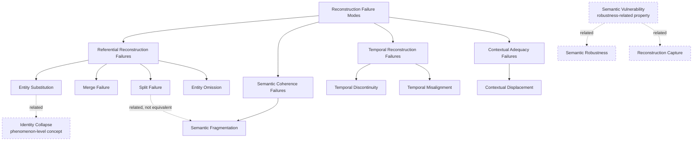

# DIO/ODI Reference Model

**Status:** v0.1.0 — SKOS-first, OWL-later  
**Author:** Daniel Beránek (ORCID: 0009-0004-0050-0264)  
**Affiliation:** Independent Researcher, Brno, Czech Republic  
**Contact:** dan@danielberanek.cz

## Purpose

This repository provides a machine-readable reference vocabulary derived from the published DIO/ODI corpus.

It does not replace the papers and does not claim to be a completed formal ontology. It provides a stable semantic layer in which machines and humans can identify DIO/ODI concepts, retrieve concise definitions, inspect conceptual hierarchy and relatedness, and trace concepts back to source publications.

The repository intentionally begins with **SKOS**. A future OWL layer should add stronger axioms only where the published corpus and subsequent review justify them.

## Concept map

The current Reconstruction Failure Mode taxonomy is non-exclusive and multi-level. Dashed relations mark related concepts that are deliberately kept outside, or distinct from, the taxonomic hierarchy.

The standalone Mermaid source is available in `docs/concept-map.mmd`.

## Why this exists

The DIO/ODI corpus is distributed across a manifesto, conceptual papers, revisions, and taxonomic notes. Free text preserves argument, nuance, genealogy, and uncertainty, but a machine must reconstruct the conceptual system from those distributed texts.

This reference model adds an explicit semantic layer above the corpus:

- concepts have stable identifiers;
- current definitions are explicit;
- broader/narrower relations are machine-readable;
- concepts that should not be conflated are structurally separated;
- historical revisions can be recorded without silently rewriting earlier publications;
- every concept can point back to its source.

In that sense, the artifact applies a core DIO principle to DIO itself: the conceptual identity of the discipline should be reconstructable from explicit, distributed, provenance-aware representations rather than inferred anew from prose every time.

## Canonical namespace

`https://vocab.danielberanek.cz/dio-odi/#`

Example concept URI:

`https://vocab.danielberanek.cz/dio-odi/#SemanticFragmentation`

The namespace is owned by the author and is intended to remain stable independently of the repository host.

## Files

- `vocabulary/dio-odi-skos.ttl` — canonical SKOS/RDF vocabulary
- `vocabulary/dio-odi.jsonld` — JSON-LD serialization
- `docs/terminology.md` — human-readable vocabulary
- `docs/source-map.md` — concept-to-source provenance
- `docs/concept-map.mmd` — Mermaid overview
- `examples/queries.sparql` — example machine queries
- `mappings/rag-pipeline-mapping.md` — DIO Reconstruction Failure Modes × RAG pipeline application mapping
- `mappings/` — application mappings, deliberately separate from the core model
- `CITATION.cff` — repository citation metadata

## Application mappings

- [DIO Reconstruction Failure Modes × RAG Pipeline Mapping](mappings/rag-pipeline-mapping.md) — a derived diagnostic mapping from the current DIO failure taxonomy to generic RAG pipeline loci, mechanisms, observable symptoms, and hypothetical incidents. It does not redefine DIO as a RAG framework.

## Primary sources

1. Beránek, D. (2026). *Manifest of Digital Identity Optimization (DIO) and Ontology of Digital Identity (ODI): Canonical Multilingual Edition* (v1). Zenodo. https://doi.org/10.5281/zenodo.21610934
2. Beránek, D. (2026). *Manifesto of Digital Identity Optimization (DIO) and the Ontology of Digital Identity (ODI)* (v2, living web edition). https://danielberanek.cz/manifesto-of-digital-identity-optimization-dio-and-ontology-of-digital-identity-odi/
3. Beránek, D. (2026). *Digital Identity Optimization (DIO): A Conceptual Framework for Entity-Based Visibility in the Age of AI-Mediated Search*. Zenodo. https://doi.org/10.5281/zenodo.21839423
4. Beránek, D. (2026). *The Crisis of Entity Resolution in Heterogeneous AI Environments: Data, Financial, and Semantic Dimensions*. Zenodo. https://doi.org/10.5281/zenodo.22257504
5. Beránek, D. (2026). *Minimum Viable Digital Identity Optimization (DIO): From Adversarial Reduction to the Semantic Field Dynamics of Digital Identity*. Zenodo. https://doi.org/10.5281/zenodo.23226205
6. Beránek, D. (2026). *From Entity Resolution Anomalies to Reconstruction Failure Modes: A Taxonomic Note Following Minimum Viable DIO*. Zenodo. https://doi.org/10.5281/zenodo.23269323

## Epistemic rule

**The reference model must not silently strengthen the theory.**

In particular:

- Identity Collapse is not defined as a sum, superclass, consequence, or cause of the current Reconstruction Failure Modes.
- Semantic Vulnerability is not classified as a Reconstruction Failure Mode.
- K6 is represented as a finer-grained candidate model, not as a logical consequence of MVDIO.

## License

The reference vocabulary and repository documentation are licensed under **Creative Commons Attribution 4.0 International (CC BY 4.0)**. See `LICENSE.md`.

## Repository

https://github.com/dan-beranek/dio-odi-reference-model
