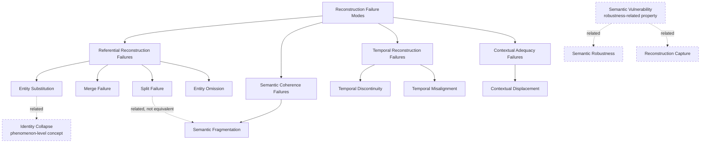

# DIO/ODI Reference Model

**Reference Model release:** v0.3.1  
**Reference Vocabulary:** v0.1.0 — SKOS-first, OWL-later  
**Release DOI:** https://doi.org/10.5281/zenodo.23290683  
**Previous archived release:** v0.3.0 — https://doi.org/10.5281/zenodo.23289615  
**Author:** Daniel Beránek (ORCID: 0009-0004-0050-0264)  
**Affiliation:** Independent Researcher, Brno, Czech Republic  
**Contact:** dan@danielberanek.cz

## Purpose

This repository provides the DIO/ODI Reference Model, centered on a machine-readable reference vocabulary derived from the published DIO/ODI corpus and extended by explicitly separated application mappings.

It does not replace the papers and does not claim to be a completed formal ontology. It provides a stable semantic layer in which machines and humans can identify DIO/ODI concepts, retrieve concise definitions, inspect conceptual hierarchy and relatedness, and trace concepts back to source publications.

The repository intentionally begins with **SKOS**. A future OWL layer should add stronger axioms only where the published corpus and subsequent review justify them.

## Concept map

The current Reconstruction Failure Mode taxonomy is non-exclusive and multi-level. Dashed relations mark related concepts that are deliberately kept outside, or distinct from, the taxonomic hierarchy.

The standalone Mermaid source is available in `docs/concept-map.mmd`.

## Why this exists

The DIO/ODI corpus is distributed across a manifesto, conceptual papers, revisions, and taxonomic notes. Free text preserves argument, nuance, genealogy, and uncertainty, but a machine must reconstruct the conceptual system from those distributed texts.

This reference model adds an explicit semantic layer above the corpus:

- concepts have stable identifiers;
- current definitions are explicit;
- broader/narrower relations are machine-readable;
- concepts that should not be conflated are structurally separated;
- historical revisions can be recorded without silently rewriting earlier publications;
- every concept can point back to its source.

In that sense, the artifact applies a core DIO principle to DIO itself: the conceptual identity of the discipline should be reconstructable from explicit, distributed, provenance-aware representations rather than inferred anew from prose every time.

## Canonical namespace

`https://vocab.danielberanek.cz/dio-odi/#`

Example concept URI:

`https://vocab.danielberanek.cz/dio-odi/#SemanticFragmentation`

The namespace is owned by the author and is intended to remain stable independently of the repository host.

## Files

- `vocabulary/dio-odi-skos.ttl` — canonical SKOS/RDF vocabulary
- `vocabulary/dio-odi.jsonld` — JSON-LD serialization
- `docs/terminology.md` — human-readable vocabulary
- `docs/source-map.md` — concept-to-source provenance
- `docs/concept-map.mmd` — Mermaid overview
- `examples/queries.sparql` — example machine queries
- `mappings/index.html` — public index of derived Application Mappings
- `mappings/rag-pipeline-mapping.md` — source for Application Mapping: DIO Reconstruction Failure Modes × RAG Pipeline
- `mappings/rag-pipeline-mapping.jsonld` — machine-readable RAG mapping representation (introduced in Reference Model v0.3.1)
- `mappings/rag-pipeline-mapping.ttl` — Turtle RDF with qualified RAG mapping assertions (introduced in Reference Model v0.3.1)
- `mappings/rag-pipeline/index.html` — human-readable RAG mapping frontend
- `mappings/hem-dio-mapping.md` — source for Application Mapping: HEM Heterogeneity Taxonomy × DIO Reconstruction Consequences
- `mappings/hem-dio-mapping.jsonld` — machine-readable metadata and mapping items for the HEM × DIO mapping
- `mappings/hem-dio-mapping.ttl` — Turtle RDF with qualified HEM × DIO mapping assertions (introduced in Reference Model v0.3.1)
- `mappings/hem-dio/index.html` — human-readable HEM × DIO mapping frontend
- `mappings/hem-dio/bridge.svg` — conceptual bridge diagram
- `mappings/` — derived application layer, deliberately separate from the canonical vocabulary
- `CITATION.cff` — repository citation metadata
- `.zenodo.json` — Zenodo-specific metadata projection for future Reference Model releases
- `metadata/works.json` — canonical operational registry of DIO/ODI works and Reference Model releases
- `metadata/relations.json` — directed inter-work relation graph
- `metadata/references.json` — canonical bibliographic references
- `metadata/README.md` — metadata-registry workflow and relation discipline

## Derived application mappings

These mappings are not part of the canonical vocabulary. They project vocabulary concepts into external domains without changing their definitions, hierarchy, or relations.

Public index: https://vocab.danielberanek.cz/mappings/

- [Application Mapping: DIO Reconstruction Failure Modes × RAG Pipeline](https://vocab.danielberanek.cz/mappings/rag-pipeline/) — a derived diagnostic mapping from the current DIO failure taxonomy to generic RAG pipeline loci, mechanisms, observable symptoms, and hypothetical incidents. It does not redefine DIO as a RAG framework. Introduced in Reference Model v0.2.0 and included in v0.3.1.
- [Application Mapping: HEM Heterogeneity Taxonomy × DIO Reconstruction Consequences](https://vocab.danielberanek.cz/mappings/hem-dio/) — uses the Heterogeneous Entity Matching taxonomy as an external analytical axis for examining how heterogeneous input conditions may contribute to DIO reconstruction failures or increase Semantic Vulnerability. HEM source: https://doi.org/10.1016/j.datak.2026.102575

The HEM × DIO mapping was introduced in **Reference Model v0.3.0** and is included in v0.3.1. The canonical Reference Vocabulary remains unchanged at v0.1.0.

## Primary sources

1. Beránek, D. (2026). *Manifest of Digital Identity Optimization (DIO) and Ontology of Digital Identity (ODI): Canonical Multilingual Edition* (v1). Zenodo. https://doi.org/10.5281/zenodo.21610934
2. Beránek, D. (2026). *Manifesto of Digital Identity Optimization (DIO) and the Ontology of Digital Identity (ODI)* (v2, living web edition). https://danielberanek.cz/manifesto-of-digital-identity-optimization-dio-and-ontology-of-digital-identity-odi/
3. Beránek, D. (2026). *Digital Identity Optimization (DIO): A Conceptual Framework for Entity-Based Visibility in the Age of AI-Mediated Search*. Zenodo. https://doi.org/10.5281/zenodo.21839423
4. Beránek, D. (2026). *The Crisis of Entity Resolution in Heterogeneous AI Environments: Data, Financial, and Semantic Dimensions*. Zenodo. https://doi.org/10.5281/zenodo.22257504
5. Beránek, D. (2026). *Minimum Viable Digital Identity Optimization (DIO): From Adversarial Reduction to the Semantic Field Dynamics of Digital Identity*. Zenodo. https://doi.org/10.5281/zenodo.23226205
6. Beránek, D. (2026). *From Entity Resolution Anomalies to Reconstruction Failure Modes: A Taxonomic Note Following Minimum Viable DIO*. Zenodo. https://doi.org/10.5281/zenodo.23269323

## Epistemic rule

**The reference model must not silently strengthen the theory.**

In particular:

- Identity Collapse is not defined as a sum, superclass, consequence, or cause of the current Reconstruction Failure Modes.
- Semantic Vulnerability is not classified as a Reconstruction Failure Mode.
- K6 is represented as a finer-grained candidate model, not as a logical consequence of MVDIO.

## Citation and archival release

**Current archived release:** DIO/ODI Reference Model v0.3.1 — https://doi.org/10.5281/zenodo.23290683

**Previous archived release:** DIO/ODI Reference Model v0.3.0 — https://doi.org/10.5281/zenodo.23289615

**Earlier archived release:** DIO/ODI Reference Model v0.2.0 — https://doi.org/10.5281/zenodo.23282752

A Reference Model release DOI identifies the versioned repository package. It is not asserted as the source of every vocabulary concept; concept provenance remains attached to the underlying DIO/ODI publications.

## License

The reference vocabulary and repository documentation are licensed under **Creative Commons Attribution 4.0 International (CC BY 4.0)**. See `LICENSE.md`.

## Repository

https://github.com/dan-beranek/dio-odi-reference-model
