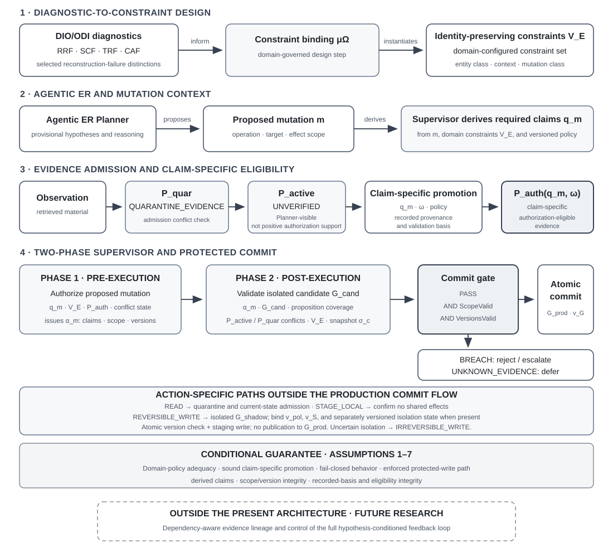

# DIO/ODI-Informed Agentic Entity Resolution: Commit-Boundary Architecture Mapping

**Artifact type:** derived architecture mapping  
**Version:** 0.3.0  
**Status:** author-curated, non-normative release candidate; aligned to production manuscript v55 (4 November 2026), prepared for arXiv v2  
**Canonical namespace:** `https://vocab.danielberanek.cz/mappings/agentic-er-architecture/#`  
**Source paper:** Daniel Beránek, *Constraining the Commit Boundary: A DIO/ODI-Informed Authorization Guardrail for Agentic Entity Resolution*, [arXiv:2610.37407](https://arxiv.org/abs/2610.37407); current public predecessor [v1 Zenodo record](https://zenodo.org/records/23580733). **Section-level source:** production manuscript `Constraining_the_Commit_Boundary_v55_production.md`, dated 4 November 2026 and prepared for arXiv v2; it is not represented as an already-public version.  
**Reference Model:** v0.6.0 release candidate, pending Zenodo archive; Reference Vocabulary v0.2.0  
**Model size:** 120 local architecture concepts; 206 qualified relation assertions  
**License:** [CC BY 4.0](https://creativecommons.org/licenses/by/4.0/)

## 1. Purpose

This artifact makes explicit the internal conceptual and functional relations of the DIO/ODI-informed commit-boundary architecture proposed for Agentic Entity Resolution (ER). It is a derived architecture mapping, not a new canonical vocabulary and not an implementation specification.

The source paper presents several connected mechanisms across its diagnostic analysis, constraint-binding proposal, evidence-promotion contract, authorization invariant, abstract interface algorithms, illustrative cases, and prospective evaluation protocol. This mapping brings those relations into one inspectable and machine-readable representation.

Its central path is:

**DIO/ODI diagnostic distinctions → domain-governed constraint binding → mutation-specific proposition requirements → claim-specific evidence eligibility → two-phase authorization → protected commit.**

The mapping also represents the different logical roles of the seven stated conditions, evidence-admission and status-precedence outcomes, version/snapshot bindings, the conditional human-adjudication path, and prospective evaluation controls. These are representations of production manuscript v55, not claims that the architecture has been implemented or empirically evaluated.

## 2. Relationship to the existing DIO/ODI resources

This mapping reuses the canonical identifiers and definitions in the [DIO/ODI Reference Vocabulary](https://vocab.danielberanek.cz/dio-odi/). It does not redefine those concepts, change their hierarchy, or add relationships to the canonical vocabulary.

It complements, rather than duplicates, the existing [DIO/ODI Commit-Boundary Contract × Policy-as-Code Authorization mapping](https://vocab.danielberanek.cz/mappings/commit-boundary-policy/):

- **This architecture mapping** describes the internal relations among the paper's diagnostic inputs, policy-binding step, evidence states, supervisor phases, commit invariant, assumptions, and evaluation design.
- **The Policy-as-Code mapping** projects selected contract obligations into OPA/Rego and Cedar capabilities, limits, and residual integration requirements.

The first is an architecture-level reconstruction; the second is an external technology mapping. Neither claims implementation or empirical validation.

## 3. Scope and interpretation boundary

### Included

- The DIO/ODI diagnostic distinctions selected by the paper.
- The partial, domain-governed constraint-binding function \(\mu_\Omega\) and its configured output \(V_E\).
- Mutation-specific derivation of the required proposition set \(q_m\) and binding in the authorization record \(\alpha_m\).
- The distinct roles of quarantined evidence, Planner-visible `UNVERIFIED` evidence, and claim-specific authorization-eligible evidence.
- Phase 1 pre-execution authorization and Phase 2 post-execution candidate validation.
- Commit-time evaluation, scope and version checks, and the conditional commit invariant.
- The seven conditional conditions and their differing logical roles, proposed evaluation conditions, common outcome reference, decision margins, author-team controls, and future-research boundary.

### Not asserted

- That the mapping is a complete formal ontology or a proof of semantic correctness.
- That the constraint-binding function is automatic SKOS entailment or that the Reference Vocabulary generates domain policies.
- That `P_active` and `P_auth` are necessarily disjoint physical stores. Their distinction is evidentiary status and permitted use; `P_auth(q_m, ω)` is claim- and context-specific.
- That authorization-eligible evidence is universally true. Its evidentiary role may be support, contradiction, or unresolved indication for a particular proposition.
- That the supervisor detects every contradiction, authenticates every source, or reconstructs unrecorded causal dependencies.
- That the complete hypothesis-conditioned feedback loop is controlled by the current architecture.
- That the architecture has been implemented, benchmarked, or empirically validated.

## 4. Architecture overview

The diagram is the human-readable overview of the same conceptual relations represented in the JSON-LD and Turtle files. Solid arrows show relations specified in the current architecture. The lower dashed region identifies future work outside the present commit-boundary contract. The guarantee band is conditional on Assumptions 1–7; Section 7.6 distinguishes enforcement premises from adequacy conditions and the fail-closed outcome rule.

## 5. Canonical DIO/ODI concepts reused

The following identifiers are reused without redefining their canonical meaning:

| Concept | Canonical URI | Role in this mapping |
|---|---|---|
| Digital Identity Optimization | `https://vocab.danielberanek.cz/dio-odi/#DIO` | Applied diagnostic and optimization framework informing the architecture |
| Ontology of Digital Identity | `https://vocab.danielberanek.cz/dio-odi/#ODI` | Theoretical/conceptual layer informing the identity-reconstruction distinctions |
| Minimum Viable Digital Identity Optimization | `https://vocab.danielberanek.cz/dio-odi/#MVDIO` | Coarse-grained analytical model referenced by the supervisor layer |
| Reconstruction Failure Mode | `https://vocab.danielberanek.cz/dio-odi/#ReconstructionFailureMode` | Canonical diagnostic hierarchy |
| Referential Reconstruction Failure | `https://vocab.danielberanek.cz/dio-odi/#ReferentialReconstructionFailure` | Referential diagnostic branch |
| Semantic Coherence Failure | `https://vocab.danielberanek.cz/dio-odi/#SemanticCoherenceFailure` | Semantic diagnostic branch |
| Temporal Reconstruction Failure | `https://vocab.danielberanek.cz/dio-odi/#TemporalReconstructionFailure` | Temporal diagnostic branch |
| Contextual Adequacy Failure | `https://vocab.danielberanek.cz/dio-odi/#ContextualAdequacyFailure` | Contextual diagnostic branch |
| Entity Substitution | `https://vocab.danielberanek.cz/dio-odi/#EntitySubstitution` | Selected referential distinction |
| Merge Failure | `https://vocab.danielberanek.cz/dio-odi/#MergeFailure` | Selected referential distinction |
| Split Failure | `https://vocab.danielberanek.cz/dio-odi/#SplitFailure` | Selected referential distinction |
| Semantic Fragmentation | `https://vocab.danielberanek.cz/dio-odi/#SemanticFragmentation` | Selected semantic distinction |
| Temporal Discontinuity | `https://vocab.danielberanek.cz/dio-odi/#TemporalDiscontinuity` | Selected temporal distinction |
| Temporal Misalignment | `https://vocab.danielberanek.cz/dio-odi/#TemporalMisalignment` | Selected temporal distinction |
| Contextual Displacement | `https://vocab.danielberanek.cz/dio-odi/#ContextualDisplacement` | Selected contextual distinction |
| Identity-Preserving Constraints | `https://vocab.danielberanek.cz/dio-odi/#IdentityPreservingConstraints` | Canonical DIO/ODI concept used as the configured constraint-set basis |
| Observation Domain | `https://vocab.danielberanek.cz/dio-odi/#ObservationDomain` | Contextual/temporal scope for evidence and claims |
| Referential Continuity | `https://vocab.danielberanek.cz/dio-odi/#ReferentialContinuity` | Continuity concept relevant to identity-changing mutations |

The mapping's restriction to selected diagnostics is deliberate. It does not project the whole Reference Vocabulary into the Agentic ER architecture.

## 6. Local architecture concepts

Paper-specific constructs are defined only in the local mapping namespace. They do not become canonical DIO/ODI vocabulary entries merely by appearing here.

| Local concept | Meaning | Epistemic status |
|---|---|---|
| `ConstraintBindingFunction` | Partial, domain-governed function \(\mu_\Omega\) connecting selected diagnostics to configured constraints | specified |
| `DomainPolicy` | Versioned policy for entity class, observation context, time, and mutation class | specified / assumed adequate |
| `DomainConfiguredConstraints` | Configured identity-preserving conditions \(V_E\) | specified as an input; content is domain supplied |
| `RequiredPropositionSet` | Mutation-specific proposition set \(q_m\), derived by the Supervisor from mutation, target/effect scope, \(V_E\), and \(v_{pol}\) | specified |
| `AuthorizationRecord` | Record \(\alpha_m\) binding proposition set, operation/effect scope, versions, and per-proposition support-record identifiers | specified |
| `QuarantineEvidence` | Evidence retained outside the Planner-visible active set pending admission/adjudication | specified |
| `ActiveEvidenceSet` | Planner-visible evidence set \(P_{active}\), potentially containing `UNVERIFIED` items | specified |
| `ClaimSpecificPromotion` | Separate auditable decision assessing evidence for a specific proposition, role, observation domain, temporal applicability, and policy | specified; correctness assumed |
| `AuthorizationEligibleEvidenceSet` | Claim- and context-specific eligibility subset \(P_{auth}(q_m, \omega) \subseteq P_{active}\), not a separate physical repository | specified; promotion correctness assumed |
| `PromotionValidationRecord` | Stable identifier for the claim-specific support/validation record bound for each required proposition | specified |
| `SharedOriginIndependenceRule` | Recorded common upstream provenance does not count as independent corroboration merely because observations are separate items | specified |
| `ShadowLineageExclusionRule` | Excludes shadow candidates and recorded claim bases transitively citing shadow content from positive promotion | specified |
| `AdmissionConflictOutcome` | Tripartite result set: `CONFLICT`, `NO_CONFLICT_DETECTED`, `INDETERMINATE` | specified |
| `StatusPrecedenceRule` | Aggregation order `BREACH` > `UNKNOWN_EVIDENCE` > `PASS` | specified |
| `HumanAdjudicationBranch` / `FreshAuthorizationDecision` | Policy- and reviewer-conditioned HITL path followed by a new authorization decision against current versions | specified |
| `GraphVersion`, `EvidenceStateVersion`, `PolicyVersion`, `ShadowVersion` | Explicit version components bound and revalidated as relevant; `v_S` is conditional on shadow use | specified |
| `AuthorizationEligibilityState` | Versioned eligibility state included in the consistent snapshot | specified |
| `CommonRetryBudget` | One retry budget shared across retry triggers in both lifecycle phases | specified |
| `CorrectiveIdentityMutation` | Protected split or corrective un-merge with policy-defined required propositions | specified |
| `CandidateGraph` | Isolated realized candidate graph \(G_{cand}\) evaluated before persistence | specified |
| `CommitSnapshot` | Consistent commit-time snapshot \(\sigma_c\) of graph, evidence, eligibility, policy, optional shadow state, and versions | specified |
| `TwoPhaseSupervisor` | Abstract MVDIO Supervisor Layer with pre-execution and post-execution phases | specified as abstract interface |
| `CommitInvariant` | Interface invariant requiring PASS, valid scope, and valid versions for protected commit | specified under assumptions |
| `ConditionalGuarantee` | The property of the protected boundary subject to seven conditions with different logical roles | conditional claim |
| `EvaluationProtocol` | Prospective comparative design with common outcome adjudication and author-team-aware uncertainty | proposed evaluation; no results |
| `CommonEvaluationReference` / `OutcomeAdjudicators` | Condition-independent criteria for SRC/UAR/FPIR applied by independent, masked adjudicators where practicable | proposed-evaluation |
| `IndependentCaseConstruction` / `TaxonomyNeutralStratum` | Independent case/stratum construction and at least one factual stratum without DIO/ODI category labels | proposed-evaluation |
| `AuthorTeamAllocation` / `PriorDIOExposureRecord` | Prespecified random or expertise-blocked team allocation and recorded prior DIO/ODI exposure | proposed-evaluation |
| `ValidatorConfiguration` | Validator class and configuration held constant; condition-specific \(q_m\) differences explicitly reported | proposed-evaluation |
| `OutcomeCountingCodebook` / `OutcomeCutoff` | Prespecified operation IDs, retry counts, terminal case resolution, confusion matrix, zero-denominator, and reconciliation rules | proposed-evaluation |
| `MultiplicityControlRule` | Uncertainty calibration for the two-route OR decision structure | proposed-evaluation |
| `DependencyAwareEvidenceFlow` | Broader tracking/control of hypothesis-conditioned derivation lineage | future research |
| `ReadAction`, `StageLocalAction`, `ReversibleWriteAction`, `IrreversibleWriteAction` | Four action classes with distinct scope, effect, and authorization semantics | specified |
| `ProductionGraph` / `ShadowGraph` | Persistent production graph and isolated provisional staging target | specified |
| `StagingIsolationState` | State of isolation from production, Planner-visible shared identity state, downstream consumers, and `P_auth` inputs | specified |
| `StagingIsolationVersion` | Version of staging-isolation state when separately versioned; no dedicated symbol is prescribed | specified when separately represented |
| `LocalDependencyVersion` | Version of a local dependency explicitly bound by `STAGE_LOCAL` only when the operation depends on it | specified |
| `PlannerVisibleSharedIdentityState` / `DownstreamConsumers` | Shared state and consumers from which provisional staging must remain isolated | specified |
| `ClaimConflictCheck` | Mutation-specific `CheckClaimConflict(q_m, P_auth, P_active, P_quar)`, distinct from admission conflict checking | specified |
| `ClaimConflictClear`, `ClaimConflictDetected`, `ClaimConflictIndeterminate` | `CLEAR`, `CONFLICT`, and `INDETERMINATE` outcomes of the mutation-specific conflict check | specified |
| `QuarantineDispositionDecision` | Recorded policy/adjudication decision that advances evidence state and triggers fresh admission before release | specified |
## 7. Relationship groups

### 7.1 Diagnostic foundation and constraint binding

The architecture is informed by DIO and ODI. Selected reconstruction-failure distinctions are inputs to a partial, domain-governed mapping \(\mu_\Omega\). The mapping is not automatic vocabulary inference. It produces or informs a domain-configured constraint set \(V_E\), whose applicability depends on entity class, observation domain, temporal conditions where relevant, and mutation class.

**Relation sequence:**

`DIO/ODI → informs → Architecture`  
`Selected diagnostic distinctions → inputTo → μΩ`  
`μΩ → produces/informs → V_E`  
`V_E → scopedBy → entity class, observation domain, temporal applicability where relevant, mutation class`

The paper also gives concrete but explicitly illustrative mappings from selected taxonomy leaves to domain-level constraint patterns:

| Canonical DIO/ODI distinction | Illustrative domain-level constraint | Authorization consequence |
|---|---|---|
| Entity Substitution / Merge Failure | Lexical similarity or commercial adjacency alone does not establish co-reference. | Do not merge without claim-specific evidence supporting the required co-reference proposition. |
| Temporal Discontinuity / Temporal Misalignment | Rename and continuity claims are bound to the relevant referent and validity interval. | Defer when temporal applicability or continuity is unresolved. |
| Semantic Fragmentation | Materially incompatible claims affecting identity remain a conflict until reconciled. | Clustering alone cannot resolve the conflict; defer the affected mutation. This mapping covers the identity-affecting subset; other attribute-level incompatibilities remain governed by domain policy. |
| Contextual Displacement | A relation such as `brand_of` may be adequate in a brand catalogue but insufficient for legal-entity identity in a compliance context. | Preserve relation typing and require evidence appropriate to the current observation purpose. |
| Split Failure / valid continuity | Documented, temporally applicable evidence may support that distinct records denote one continuing entity. | Resolve only when claim-specific evidence and all applicable constraints pass. |

These rows are examples from the paper's domain-binding discussion, not universal policies, automatically inferred rules, or validated mappings for every entity class. The machine-readable graph marks these particular relations as `illustrative`.

### 7.2 Mutation and proposition binding

The Supervisor derives the required proposition set from the proposed mutation, its target/effect scope, the configured constraint set, and the applicable policy version:

\[
q_m := \operatorname{DeriveRequiredClaims}(m,V_E,v_{\mathrm{pol}}),
\]

where the target/effect scope is part of the mutation input and the observation context \(\omega\) is fixed by the versioned policy instance bound through \(v_{\mathrm{pol}}\). The Planner cannot replace or weaken the derived proposition set. The authorization record \(\alpha_m\) binds the derived set, operation type, target/effect scope, policy version, and relevant state versions. For each required proposition, it also identifies the promotion/validation record whose claim-specific support is relied upon.

**Relation sequence:**

`Mutation m + target/effect scope + V_E + v_pol → DeriveRequiredClaims → q_m`  
`v_pol → fixes → observation context ω`  
`q_m → boundIn → α_m`  
`α_m → binds → operation scope + v_G + v_E + v_pol + v_S (if used)`  
`α_m → identifies per-proposition → promotion/validation record`

### 7.3 Evidence admission and claim-specific eligibility

Retrieved observations first enter \(P_{quar}\). The admission check returns one of three outcomes: `CONFLICT`, `NO_CONFLICT_DETECTED`, or `INDETERMINATE`. A conflict or indeterminate result retains the observation in quarantine; `NO_CONFLICT_DETECTED` permits possible admission but does not establish identity or prove the absence of all conflicts. Following admission, an observation may enter \(P_{active}\) as `UNVERIFIED`. This is an admission-level status: claim-specific eligibility has not yet been established for the proposition under assessment. It is not a universal truth or falsity label.

A separate promotion decision evaluates the specific proposition, observation domain \(\omega\), temporal applicability, evidentiary role, recorded provenance, validation basis, and applicable policy/version. Eligibility is a subset relation, not physical separation:

A second, mutation-specific check is distinct from admission checking: `CheckClaimConflict(q_m, P_auth, P_active, P_quar)`. It returns `CLEAR` only when no unresolved material conflict bearing on the propositions in `q_m` is detected; `CONFLICT` only when claim-specific authorization-eligible evidence establishes a relevant contradiction or prohibitive condition; and `INDETERMINATE` when a possible conflict is indicated only by `UNVERIFIED` or quarantined evidence, or eligible conflicts cannot be reconciled under the applicable authority and temporal rules. `CONFLICT` and `INDETERMINATE` both prevent `PASS`; an established prohibitive condition yields `BREACH`, while unresolved/indeterminate conflict yields `UNKNOWN_EVIDENCE`.

A quarantined item is not released merely because it has been escalated. A policy-designated adjudication or versioned rule must determine and record its disposition, advance the evidence-state version, and trigger a fresh admission check before release to `P_active`. Release confers only `UNVERIFIED` status; it is not promotion into `P_auth`. Eligibility metadata may be changed only through the designated claim-specific promotion process or a versioned policy/adjudication operation; neither the Planner nor raw tool output may set it directly.

\[
P_{auth}(q_m,\omega) \subseteq P_{active}.
\]

The same source may support one proposition and be insufficient or contradictory for another. Each role is recorded per proposition. Positive support, contradiction, and unresolved indication are not interchangeable.

The promotion contract also applies two explicit provenance restrictions. First, observations whose recorded upstream query, hypothesis, source, or derivation path is shared must not be counted as independent corroboration merely because they appear as distinct items. Second, a promoted claim must not rely on a shadow candidate or on a recorded claim basis that transitively cites shadow content. These restrictions operate on recorded provenance; they do not imply comprehensive reconstruction of unrecorded causal dependencies.

**Relation sequence:**

`Observation → enters → P_quar`  
`Admission check → CONFLICT / NO_CONFLICT_DETECTED / INDETERMINATE`  
`NO_CONFLICT_DETECTED → may admit as UNVERIFIED → P_active`  
`P_auth(q_m, ω) → isSubsetOf → P_active`  
`P_active → visibleTo → Planner`  
`ClaimSpecificPromotion(q_m, ω, policy, provenance) → assesses → evidence item`  
`Promotion → applies → shared-origin independence restriction + shadow-lineage exclusion`  
`Promotion → grants eligibilityFor → specific proposition / role / context`  
`α_m → identifies per proposition → promotion/validation record`

### 7.4 Action-specific authorization and staging isolation

The interface distinguishes four operation classes rather than treating every tool action as a graph mutation:

- `READ` authorizes retrieval within a declared scope. It does not bind pre-retrieval graph or evidence versions whose unrelated change would force the retrieval to be replayed. The returned observation is admitted against the current evidence-state version through the quarantine protocol.
- `STAGE_LOCAL` authorizes local preparation with no shared-state effects. It binds a local dependency version only when the declared operation explicitly depends on it; post-execution validation confirms the absence of shared effects.
- `REVERSIBLE_WRITE` authorizes only provisional staging to an isolated target such as `G_shadow`. The staging target must be separated from production identity state, Planner-visible shared identity state, downstream consumers, and all `P_auth` inputs. The authorization binds `v_S`, the applicable policy version `v_{pol}`, and any separately versioned staging-isolation state relevant to the action. The manuscript does not prescribe a dedicated symbol for that optional isolation-state version.
- `IRREVERSIBLE_WRITE` is the protected path for a realized or potential shared effect that can alter identity interpretation. If isolation or operation classification is uncertain, the action is treated as `IRREVERSIBLE_WRITE`, not as provisionally reversible. The term describes the authorization boundary and does not assert that technical rollback is impossible.

For `REVERSIBLE_WRITE`, the consistent snapshot includes staging-isolation state and its version when separately versioned. The shadow write and comparison of `v_S`, `v_{pol}`, and every other bound staging-relevant version occur atomically at the action's linearization point. A mismatch prevents staging and consumes the common retry budget; successful staging advances `v_S` and returns `SHADOW_STAGED_PROVISIONAL`, but does not authorize publication to `G_{prod}`. If isolation cannot be verified, the candidate is discarded; any shared-identity attempt must restart through the protected `IRREVERSIBLE_WRITE` path.

**Relation sequence:**

`READ → scoped retrieval → quarantine → current-state admission`  
`STAGE_LOCAL → local-only preparation → post-execution no-shared-effect confirmation`  
`REVERSIBLE_WRITE → positive isolation verification → version-bound atomic stage in G_shadow`  
`IRREVERSIBLE_WRITE → two-phase authorization → protected production commit`

### 7.5 Two-phase authorization and commit

**Phase 1 — Pre-execution authorization** derives the required claims and checks the proposed protected operation against the applicable policy, claim-specific evidence eligibility, conflicts, and declared scope. If the preconditions pass, it issues \(\alpha_m\), binding the claim set, operation scope, relevant versions, and the promotion/validation record identifiers relied upon for each required proposition.

**Phase 2 — Post-execution validation** evaluates the realized candidate \(G_{cand}\) in isolation. It re-derives the required claims, checks consistency with \(\alpha_m\), and verifies in the same snapshot \(\sigma_c\) that each referenced promotion/validation record remains present and that its proposition-specific role, support, applicability, and policy version still hold. The snapshot includes authorization-eligibility state. For a protected commit, bound version components are \(v_G\), \(v_E\), \(v_{pol}\), and \(v_S\) when shadow state is used; one evidence-state version covers active/quarantined evidence and promotion-eligibility changes.

A protected commit requires all of the following:

\[
EvaluateGraphConstraints = PASS \quad\land\quad ScopeValid(m,\alpha_m) \quad\land\quad VersionsValid(\alpha_m,\sigma_c).
\]

Status aggregation follows `BREACH` > `UNKNOWN_EVIDENCE` > `PASS`. `BREACH` leads to rejection/escalation. `UNKNOWN_EVIDENCE` blocks commit and leads to `HALT_HITL` only when policy requires human review and a reviewer is available; otherwise it leads to `DEFER_UNRESOLVED`. A human decision that changes case disposition requires a fresh authorization decision against current versions; it cannot revive a stale candidate. One common retry budget covers the retry triggers in both lifecycle phases, including version/snapshot conflicts, shadow-version changes, and evidence-admission compare-and-swap failures.

The same protected boundary applies to merges, splits, and corrective un-merges when their realized or potential shared effects can alter identity interpretation. The policy derives a mutation-specific proposition set for each operation; a corrective operation does not inherit authority from the earlier mutation.

### 7.6 Guarantee and assumptions

The commit invariant is an interface invariant, not a theorem of semantic correctness. The seven stated conditions have different logical roles and should not be read as interchangeable premises:

1. **Domain-policy adequacy** — an adequacy condition for interpreting `PASS` as support for the intended identity claim.
2. **Claim-specific promotion correctness** — an adequacy condition for interpreting recorded eligible evidence as having the roles and applicability assigned to it.
3. **Fail-closed outcome handling** — the outcome contract itself: insufficient positive support or unresolved material conflict yields `UNKNOWN_EVIDENCE` and cannot authorize an irreversible mutation. This restates the status/commit rule rather than supplying an independent semantic premise.
4. **Enforced and conservative mutation classification** — an enforcement premise: every relevant production write passes through the Supervisor and potentially identity-changing operations are protected.
5. **Supervisor-derived authorization propositions** — a binding premise: the Supervisor derives \(q_m\) from the mutation, target/effect scope, configured constraints, and versioned policy; the Planner cannot weaken it.
6. **Scope and version integrity** — an enforcement premise: authorized scope and relevant graph, evidence, policy, eligibility, and optional shadow versions remain valid at commit.
7. **Recorded-basis and eligibility integrity** — an adequacy condition: the promotion process controls eligibility metadata and applies recorded-provenance restrictions; unrecorded derivations remain outside the guarantee.

The Supervisor does not independently authenticate every source, prove semantic truth, detect conflicts absent from its inputs, or reconstruct provenance derivations that are not recorded.

### 7.7 Evaluation relations

The proposed protocol compares **at least four** conditions: unconstrained Agentic ER (Baseline A), conventional identifier/default-deny rules (Baseline B), a generic two-phase authorization boundary (Baseline C), and the DIO/ODI-informed Challenger. The Baseline C–Challenger comparison tests incremental diagnostic-to-constraint organization.

Baseline C and Challenger use the same case inventory, underlying domain facts, evidence-promotion process, validator class and configuration, action resources, and decision budget. Policy-derived \(q_m\) sets may differ because policy organization is the intended treatment pathway; those differences must be reported. Case inventories and diagnostic strata are constructed or independently reviewed by a party outside both policy-authoring teams and without access to frozen policies. At least one taxonomy-neutral stratum, defined from observable case facts without DIO/ODI labels, is reported alongside diagnostic strata. Cases governed only by shared promotion rules (for example, recorded shared-origin dependence) are common-control tests unless a separate mapping difference is also tested.

Baseline C authors do not receive the DIO/ODI mapping, category labels, or Challenger policy. Both conditions receive the same underlying factual annotations. Authoring effort, time, relevant ER/policy expertise, and non-policy resources are matched as far as practicable; counterpart policies/results remain blinded until versions are frozen. Prior DIO/ODI exposure is recorded. With one author or team per condition, results are exploratory team-level comparisons. For stronger inference, multiple independent teams per condition are assigned by a prespecified random or expertise-blocked procedure. Repeated runs of one authored policy are not independent authoring replications; uncertainty analysis must reflect between-team variation.

For SRC, UAR, and FPIR, correctness, safety, admissibility, resolvability, and benignness are adjudicated against a common independent evaluation reference, not either condition's operational policy. Outcome adjudicators are independent of policy authors and masked to condition where practicable. PEVR separately assesses compliance with the applicable operational contract. Policy-permitted mutations and referential correctness remain separate labels.

Before outcomes are examined, task- and policy-family-specific margins for acceptable SRC loss and RFCR increase, the uncertainty procedure and interval level, analysis unit, case/stratum weights, and aggregation rule are fixed. The decision rule has two binding routes: (1) lower RFCR at non-inferior SRC, requiring \(L_S>-\delta_{SRC}\) and \(U_R<0\); or (2) improved SRC without a material RFCR increase, requiring \(L_S>0\) and \(U_R\leq\delta_{RFCR}\). Both margins are nonnegative and risk-justified before outcomes. The uncertainty procedure must account for the two-route OR structure when calibrating the overall claim criterion, for example through simultaneous bounds or another prespecified multiplicity-control approach. If RFCR is undefined in either condition, RFCR-based routes are non-evaluable and do not establish safety superiority or inferiority. Failure to establish either route is not proof of equivalence or harm. No benchmark results are claimed.

The counting codebook defines a unique attempted protected mutation by `operation_id`; retries/re-evaluations for the same operation count once. It also fixes the observation/reconciliation cutoff, terminal resolution (including correct non-match outcomes), benign/resolvable/admissible labels, confusion-matrix mapping, and zero-denominator conventions. Still-unknown transaction outcomes at the cutoff remain unknown. Policy-authoring and corpus-construction costs are reported separately from system CCR unless expressly included under a declared common costing horizon.

### 7.8 Future-research boundary

Dependency-aware evidence lineage and control of the full hypothesis-conditioned Plan–Act–Observe–Update loop are represented as a future-research extension, not a current Supervisor capability. The present architecture governs authorization at the protected persistence boundary; it does not eliminate upstream hypothesis-conditioned retrieval or prove that observations are independent.

## 8. Epistemic-status vocabulary

| Status | Meaning |
|---|---|
| `specified` | Explicitly defined as part of the current conceptual architecture or interface contract |
| `assumed` | Required for the conditional guarantee but not established by the Supervisor specification |
| `illustrative` | Used to explain a possible pathway or domain example; not asserted as universal |
| `proposed-evaluation` | Part of a prospective protocol; no empirical result is claimed |
| `future-research` | Explicitly outside the present architecture and reserved for later investigation |
| `canonical-reference` | An existing DIO/ODI Reference Vocabulary concept reused without redefining it |

Every qualified relation assertion in JSON-LD and Turtle carries a source section, interpretation note, and epistemic status. Section references anchor assertions to production manuscript `Constraining_the_Commit_Boundary_v55_production.md` dated 4 November 2026. The public arXiv v1 is identified as the published source counterpart; section-level anchors in this release candidate follow production manuscript v55 prepared for arXiv v2.

## 9. Machine-readable files

- [JSON-LD](agentic-er-commit-boundary-architecture-mapping.jsonld)
- [Turtle RDF](agentic-er-commit-boundary-architecture-mapping.ttl)
- [Architecture SVG](agentic-er-architecture/architecture.svg)
- [Human-readable architecture page](agentic-er-architecture/)

The JSON-LD graph contains 120 local architecture concepts and 206 qualified relation assertions. The RDF representation uses qualified relation assertions so that the subject–predicate–object relation, source section, explanatory note, and epistemic status remain associated. It does not add these local architecture terms or relations to the canonical SKOS vocabulary.

## 10. References

1. Beránek, D. (2026). *Constraining the Commit Boundary: A DIO/ODI-Informed Authorization Guardrail for Agentic Entity Resolution* [Preprint, version 1]. arXiv. DOI [10.48550/arXiv.2610.37407](https://doi.org/10.48550/arXiv.2610.37407). Zenodo. Concept DOI [10.5281/zenodo.23580732](https://doi.org/10.5281/zenodo.23580732).

2. Beránek, D. (2026, October 25). *DIO/ODI Commit-Boundary Contract × Policy-as-Code Authorization* [Application mapping]. DIO/ODI Reference Model. https://vocab.danielberanek.cz/mappings/commit-boundary-policy/.

3. Beránek, D. (2026). *DIO/ODI Reference Model* (Version 0.5.0) [Software]. Zenodo. DOI [10.5281/zenodo.23643845](https://doi.org/10.5281/zenodo.23643845).

4. Beránek, D. (2026). *DIO/ODI Reference Model* [Reference vocabulary, version 0.2.0]. Zenodo. Concept DOI [10.5281/zenodo.23272897](https://doi.org/10.5281/zenodo.23272897). [Current vocabulary page](https://vocab.danielberanek.cz/dio-odi/).

Section-level anchors align with production manuscript v55 dated 4 November 2026, used as an unpublished source for the pending arXiv v2 submission. The public arXiv citation identifies the current v1 predecessor separately.
---

**Author:** Daniel Beránek · ORCID 0009-0004-0050-0264  
**Status note:** mapping v0.3.0, section-aligned to production manuscript v55 dated 4 November 2026. This is a derived, non-normative architecture representation. It does not modify the DIO/ODI Reference Vocabulary and does not claim an implemented or empirically validated system.